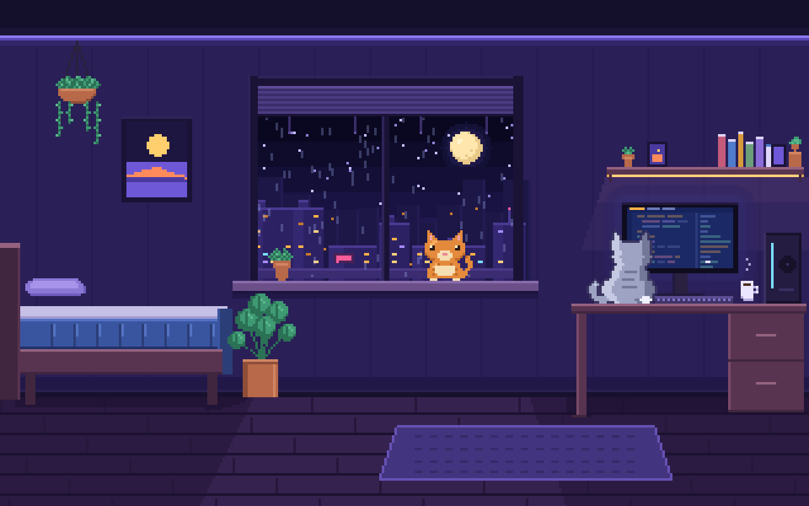
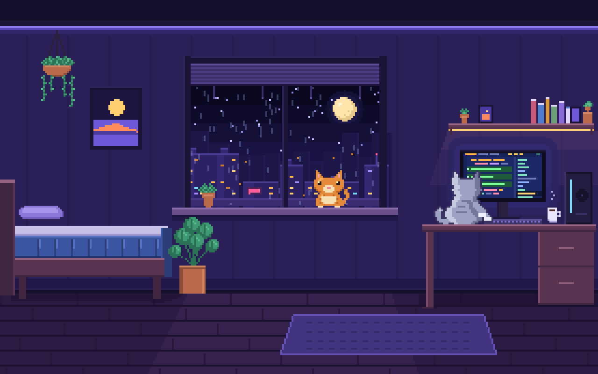
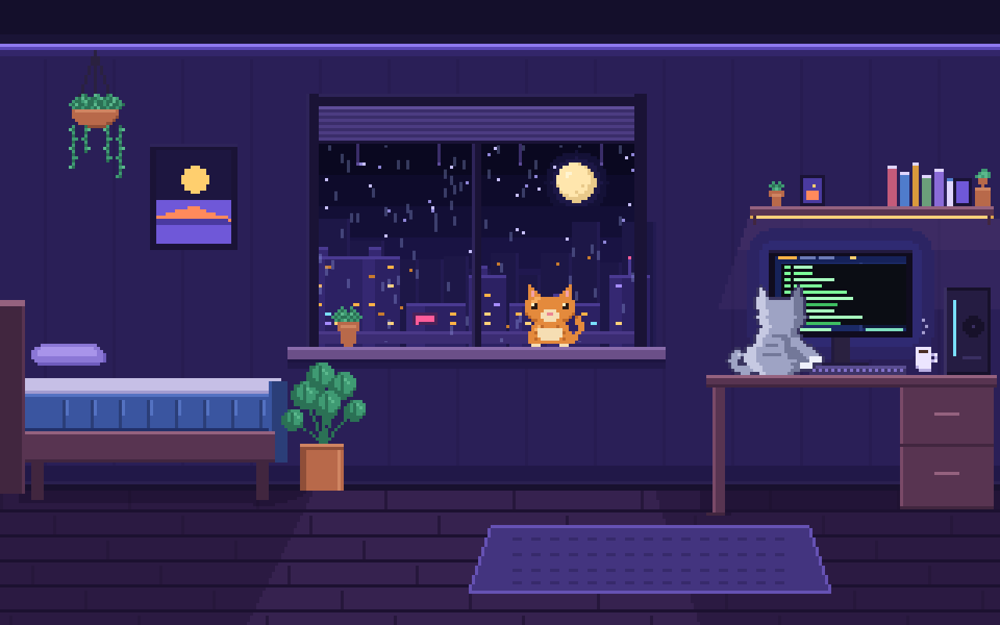
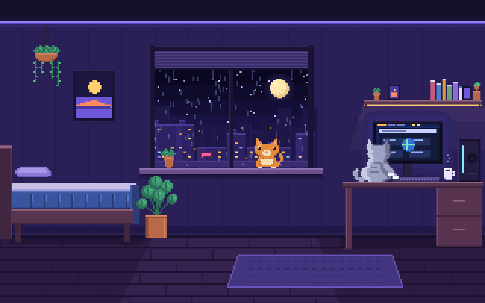
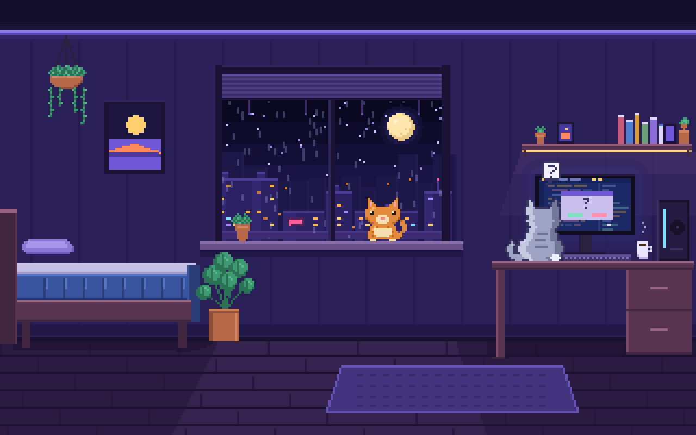
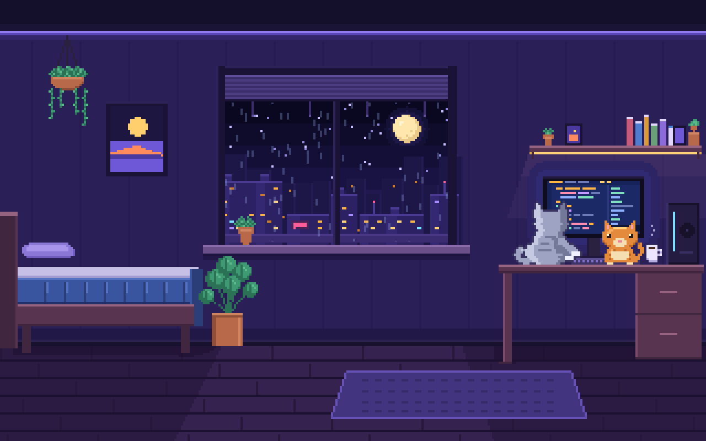
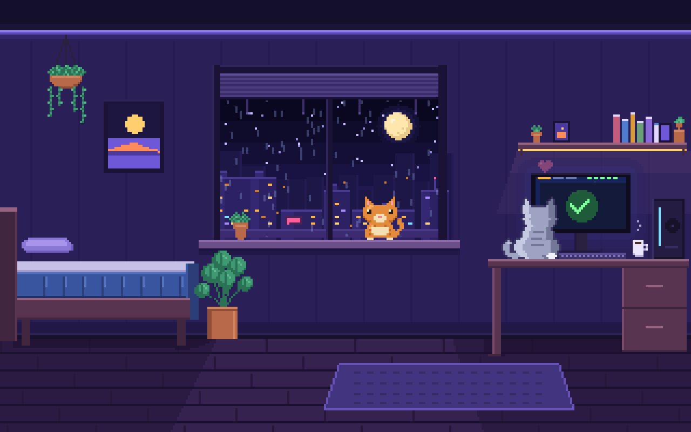
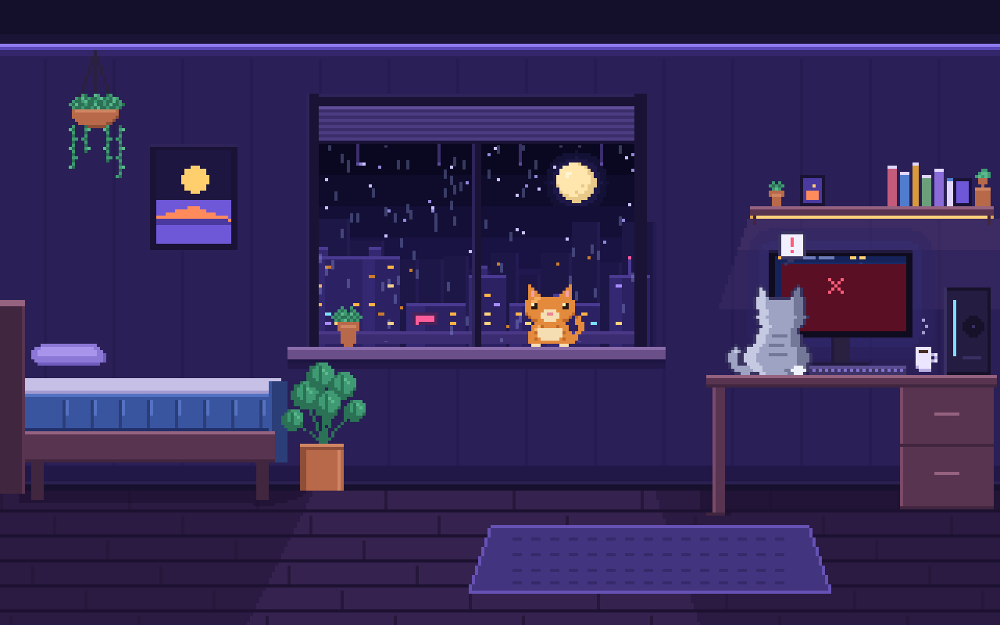
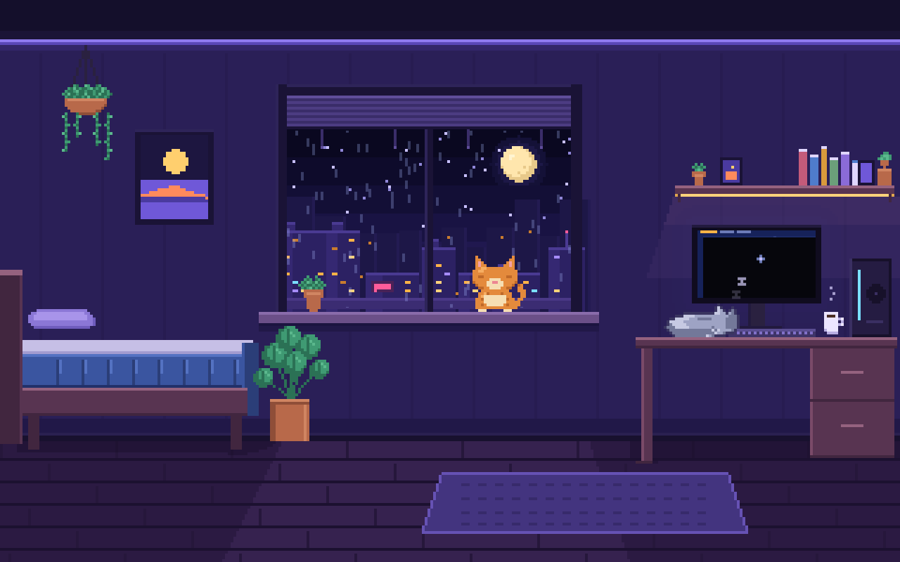
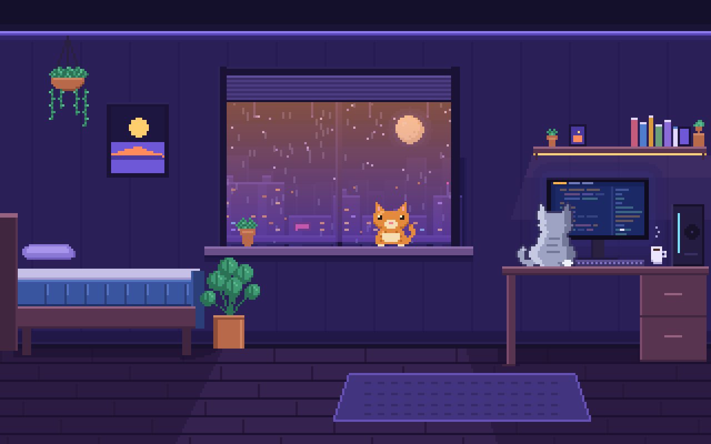

# Pixel District

Claude の会話の後ろに、夜のピクセルアートの部屋を映す Claude Code の mod です。
雨の窓、またたく街の灯り、そして 2 匹の猫。Claude が働いている間はグレーの猫がキーボードを叩き、
ツールを使うたびにモニターの画面が変わり、終わると ✓ とハートで知らせてくれます。

*A Claude Code mod that puts a night pixel-art room behind your Claude conversation. The grey cat codes while Claude works.*

**▶ ブラウザで見る（インストール不要）: https://xneoxgenesisx.github.io/pixel-district/**
全部の状態をボタンで切り替えられます。スマホでも見られます。

- 動きはどれも小さく静かです（作業の邪魔をしない「ちょっと動いてる」くらい）
- Claude のパネルや文字の色はアプリのまま。変わるのは背景だけです
- ネットワーク通信なし・ファイル読み込みなし。シーンは mod の中に入っています
- 「視差効果を減らす」設定（reduced motion）では動きが止まります

## すぐにインストールする

Claude デスクトップアプリ（Code タブ）かモバイルアプリで表示されます（ターミナル版は背景を描きません）。
ターミナルで 2 行実行して、新しいセッションを開くだけです。

```bash
claude plugin marketplace add xNEOxGENESISx/pixel-district
```

```bash
claude plugin install pixel-district@pixel-district
```

**Claude Code に頼んでもインストールできます。** 入力欄に次の一文を送るだけです（または [install.html](install.html) を添付して「これをインストールして」）。

```
https://xneoxgenesisx.github.io/pixel-district/install.html の手順で Pixel District をインストールして
```

図入りの手順書: https://xneoxgenesisx.github.io/pixel-district/install.html

ほかの入れ方（クローンしてローカルから読み込む、試しに 1 セッションだけ使う）とアンインストールは
[docs/INSTALL.md](docs/INSTALL.md) にあります。

## ドキュメント

| やりたいこと | 読むもの |
|---|---|
| 自分の環境に入れる・外す | [docs/INSTALL.md](docs/INSTALL.md) |
| 色・動き・透け具合・タイミングを変える | [docs/CUSTOMIZE.md](docs/CUSTOMIZE.md) |
| 自分だけの部屋（look）をゼロから作る | [docs/FROM-SCRATCH.md](docs/FROM-SCRATCH.md) |

## 部屋が見せる Claude の状態

| Claude の状態 | 部屋の様子 |
|---|---|
| 待機中 | 猫は座ってしっぽをゆっくり振る。画面は暗め |
| メッセージを送った | 猫が「!」で気づく |
| 考えている / 作業中 | 猫が速くタイピング、コードがスクロール |
| ターミナル・ファイルを読む・編集・Web | モニターにそれぞれの画面 |
| あなたの返事待ち（許可・質問） | 猫が振り向いて「?」 |
| サブエージェントが動いている | オレンジの猫が手伝いに来る |
| 終わった | ✓ とハートときらきら。ステップが多いと少し豪華に |
| エラー / 中断 | 画面が揺れる / 止まる |
| 3 分放っておく | 猫が眠る（Zz） |
| 利用上限が近い | マグカップが空になる |
| 朝・昼・夕方 | 時刻に合わせて空の色が変わる |

## ローカルでプレビューする

```bash
python3 -m http.server 4039
```

ブラウザで `http://localhost:4039/preview/states.html` を開くと、全部の状態をボタンで切り替えられます（公開版と同じページです）。
`?auto=1` を付けると 4 秒ごとに自動で切り替わります。

## フォルダ構成

```
plugin/              mod 本体（これをインストールする）
  hooks/register.tsx   Claude の状態 → 部屋の状態（設定値は先頭にまとまっています）
  hooks/scene.ts       シーンの SVG（tools/gen_scene.py が生成。手で編集しない）
  tests/               mod のテスト
scene/scene.svg      生成されたシーン（プレビュー用）
tools/gen_scene.py   部屋をコードで描くジェネレーター（Python 3、追加ライブラリ不要）
tools/build_install.py  install.html にシーンを埋め込む（gen_scene.py が自動で呼ぶ）
install.html         配布用の手順書。画像も中に入っていて、この 1 ファイルだけで見られる
preview/             状態切り替え・拡大表示のプレビューページ
docs/                インストール・カスタマイズ・ゼロから作る方法
```

## ライセンス

[MIT](LICENSE)。自由に改造して、自分の部屋を作って配ってください。

## スクリーンショット

| | |
|---|---|
|  待機中 |  コードを編集中 |
|  ターミナル |  Web を見ている |
|  あなたの返事待ち |  サブエージェントが手伝い中 |
|  完了 ✓ |  エラー |
|  放っておくと眠る |  夕方の空 |
